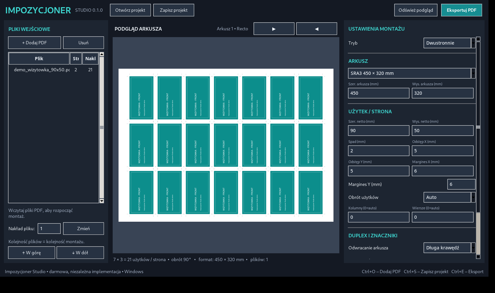

# Impozycjoner Studio 0.2.6

Rozwijana **wersja alpha** niezależnej, darmowej aplikacji do impozycji PDF, wzorowanej funkcjonalnie na procesach znanych z programu Impozycjoner 4. Wersja 0.2.6 **nie jest jeszcze pełnym zamiennikiem Impozycjonera 4**. Nie zawiera jego kodu, plików ani znaków handlowych.

## Uruchomienie na Windows 10/11

1. Zainstaluj Python 3.11 lub nowszy z python.org (zaznacz *Add Python to PATH*).
2. Rozpakuj ZIP do folderu na komputerze.
3. Kliknij dwukrotnie **`START_WINDOWS.bat`**. Plik automatycznie instaluje zależności i uruchamia aplikację. Przy kolejnych uruchomieniach korzysta z tego samego środowiska.
4. Jeśli pip jest nieobecny w `.venv`, launcher sam spróbuje `ensurepip`, a w razie potrzeby odtworzy środowisko. Skrypt `BOOTSTRAP_WINDOWS.bat` służy do samego przygotowania/naprawy środowiska.
5. Aby wygenerować własny katalog z plikiem .exe uruchom **`BUILD_EXE_WINDOWS.bat`**, potem `dist/Impozycjoner-Studio/Impozycjoner-Studio.exe`.

## Co jest dostępne

- Import wielostronicowych PDF, wiele plików i różne nakłady.
- Arkusze predefiniowane: SRA3/SRA4/A3/A4/B2; dowolny rozmiar w mm.
- Automatyczna siatka z obrotem 0/90° wybierająca więcej użytków.
- Ręcznie ustawiane wymiary, spady, odstępy, marginesy i kolumny/wiersze.
- Aktualizowany podgląd prawdziwego wynikowego PDF.
- Montaż jednostronny i dwustronny z definiowaniem przodów, sparowanych tyłów oraz jednego wspólnego rewersu — całe pliki lub wybrane strony. Jeśli nic nie oznaczysz, działa dawne parowanie 1/2, 3/4. Obrót według wskazanej krótkiej/długiej krawędzi arkusza.
- Podstawowa broszura zeszytowa 2-up, oprawa zeszytowa; automatyczne puste strony do wielokrotności czterech.
- Linie cięcia (wektorowe), numery stron; wektorowy wynikowy PDF bez rasteryzacji zawartości.
- **Jawne skalowanie wielostronicowego PDF do innego formatu netto**: Bez skalowania (blokada niezgodnych formatów), Dopasuj (proporcjonalnie, cała treść, możliwe marginesy) lub Wypełnij (proporcjonalnie, przycięcie). Brak rozciągania w trybach skalowania.
- Presety formatów docelowych: A6 pion/poziom, A5 pion/poziom i A4 pion/poziom oraz wymiary własne.
- **Eksportuj pojedyncze strony**: tworzy nowy wielostronicowy PDF, w którym każda strona ma docelowy format netto (albo format netto + skonfigurowany spad). Alternatywnie można skalować bezpośrednio podczas montażu na arkuszu.
- Poprawna interpretacja MediaBox z przesuniętym początkiem (również przy CropBox/TrimBox/BleedBox) — bez fałszywego błędu TRIMBOX; ten sam układ jest stosowany przy eksporcie.
- **Preflight PDF**: kontrola wymiarów TrimBox każdej strony, dostępnego fizycznego spadu, uproszczone DPI obrazów i fontów, TXT/JSON; błędy geometrii blokują eksport, a ostrzeżenia wymagają potwierdzenia.
- **Preflight 0.2.3**: raport ostrzega, gdy jeden PDF zawiera różne rozmiary stron (np. strony 1–12 A4 i 13–22 A6). Ostrzeżenia DPI są zgrupowane na stronę, a kompletne dane każdego problematycznego obrazu (w tym efektywne DPI po skalowaniu, położenie w pt i wymiary pikselowe) pozostają w eksporcie JSON.
- Poprawione umieszczanie spadów przy obrocie użytków 90/180/270° i źródłowych stron PDF z /Rotate; źródłowego PDF nie rozciągamy automatycznie, jeśli format nie pasuje.
- Zapis/odczyt projektu `.psimp` (archiwum ZIP + JSON, względne ścieżki PDF i przypisania roli każdej strony; oryginalne pliki nie są kopiowane do projektu).

## Ograniczenia — ważne w druku produkcyjnym

- Poprawka 0.2.1 została sprawdzona na syntetycznych PDF z przesuniętym MediaBox. Przed nakładem zawsze zweryfikuj plik kontrolny, zwłaszcza przy nietypowych eksportach DTP.

- Przed produkcją **sprawdź kontrolny PDF i wydruk dwustronny**, szczególnie orientację recto/verso na konkretnej maszynie.
- W tej wersji nie ma jeszcze gang-run, impozycji wykrojników, offsetowych paserów, pełnego preflightu CMYK/spot/ICC/PDF-X, creep ani kompletnych schematów falcowania.
- W trybie Dwustronnie strony oznaczone `Normalnie` są łączone w pary 1/2, 3/4 w ramach danego pliku/nakładu; osobne strony `Przód` są łączone z `Tył sparowany` w kolejności wybranych plików/stron. `Tył wspólny` jest tylko jeden na projekt i powtarza się pod wszystkimi przodami; w tej sytuacji nieoznaczone strony również stają się przodami. Zbyt mało sparowanych tyłów bez wspólnego tyłu powoduje błąd preflight. Przypisanie rewersu wymaga trybu **Dwustronnie**. W innych trybach działa jedynie `Pomiń`.
- W trybie broszury jest tylko jeden plik wejściowy, a ustawiona szerokość/wysokość użytku dotyczy **pojedynczej strony po złożeniu**. To prosty układ 2-up, bez korekcji creep.
- Program **nie tworzy nowych spadów z powietrza**. Jeśli źródło PDF nie ma fizycznego obrazu poza TrimBox, obszar spadu pozostanie pusty. Kontrola sprawdza dostępny obszar w geometrii pliku, **nie** potwierdza, że grafika faktycznie wypełnia spad.
- Preflight jest **uproszczony**: wykrywa część potencjalnie nieosadzonych fontów i niskie DPI rastrowe, ale nie zastępuje profesjonalnej inspekcji separacji, overprintu czy PDF/X. Próg DPI weryfikuje obrazki heurystycznie, nie analizuje całego wyglądu strony.
- Przy ustawieniu **Bez skalowania** rozmiar TrimBox źródłowego PDF musi odpowiadać użytkowi (tolerancja 0,5 mm). Przy różnych rozmiarach wyświetlany jest błąd. W trybach **Dopasuj / Wypełnij** operator jawnie decyduje o przeskalowaniu.
- Znaczniki przy małych odstępach mogą wchodzić w obszar innych użytków, dlatego przed produkcją wykonaj kontrolę podglądu.
- Przy dużych nakładach eksport odbywa się w głównym wątku GUI i może chwilowo blokować okno.

## 0.2.6 — Generator naklejek TAXI (Szczecin)

Osobna zakładka zastępująca **Generator etykiet z maili**. Bez logowania IMAP, bez podawania danych klientów.

### Generowanie w aplikacji

1. Otwórz **Generator naklejek TAXI**.
2. Wpisz jeden lub wiele numerów, np. `1740, 1713` (albo po jednym wierszu).
3. Kliknij **GENERUJ KOMPLET NAKLEJEK TAXI → ZIP** i wybierz miejsce zapisu.
4. Dla każdego numeru otrzymasz jego osobny folder zawierający:
   - `<NUMER>_lewy.tif` i `<NUMER>_prawy.tif` — TIFF 2283 × 1102 px, 200 DPI, z zachowanym herbem Szczecina i napisem SZCZECIN; podmieniany jest tylko numer.
   - `<NUMER>_TYL.ai` — **EPS-based PostScript AI** ze znakami zamienionymi na krzywe; *nie* jest to nowoczesny plik Illustrator CC/PDF.
   - `<NUMER>_TYL.eps` — taki sam wektorowy projekt jako klasyczny EPS do importu w CorelDRAW X4.
   - `<NUMER>_TYL.svg` — alternatywne edytowalne krzywe.
   - `<NUMER>_TYL_PODGLAD.png` — obraz do sprawdzenia wyglądu, **nie** do cięcia.

Tył na A4 odtwarza układ przesłanego wzorca `TAXI TYL.cdr`: górny numer / SZCZECIN / odwrócone SZCZECIN / odwrócony numer. Wzorzec CDR ma numer **1713**, a dostarczone TIFF-y boczne mają **1740**. Wygenerowane napisy i liczby są obrysami wektorowymi (nie bitmapami, nie aktywnym fontem). Oryginalny CDR nie jest dołączany, nie generujemy natywnego CDR.

**Font:** oryginalny wzór był wykonany w *Impact*. Na typowym Windows program używa systemowego `C:\Windows\Fonts\impact.ttf` i przelicza jego obrysy na ścieżki bez kopiowania fontu. Jeśli Impact nie jest dostępny, można wskazać plik `Impact.ttf` z uprawnionej instalacji Windows. Na Linux/testach używany jest font zastępczy — takie pliki **nie są 1:1 zgodne wizualnie** z oryginałem.

**CorelDRAW X4 / ploter:** `AI` jest wersją opartą na starszym EPS/PS, `EPS` jest plikiem zapasowym. Import wektorów EPS/AI został sprawdzony w LibreOffice Draw jako osobne ścieżki, ale **nie potwierdzono jeszcze otwarcia ani cięcia w rzeczywistym CorelDRAW X4**. Przy pierwszym użyciu zaimportuj `.eps` lub `.ai`, sprawdź wymiar strony A4 210 × 297 mm, rozmiar obrysów, ich kolejność i zrób próbne cięcie. **Nie rozpoczynaj produkcji bez kontroli na swojej maszynie.**

### Generowanie z konsoli

```powershell
python taxi_generator.py 1740 1713 -o TAXI_zamowienie.zip
```

Wygenerowany ZIP zawiera wskazane numery i tylko ich dedykowane pliki. Wzory źródłowe boków są w `assets/taxi`.

## 0.2.4 — przód / tył: dwa pliki i jeden wspólny rewers

1. Ustaw **Tryb → Dwustronnie**.
2. Dodaj PDF `Przody.pdf` i PDF `Tyl.pdf`.
3. Zaznacz `Przody.pdf`, kliknij **Przód / tył — role pliku i stron…**. Wybierz `Przód`, kliknij **Ustaw rolę CAŁEGO PLIKU** i **Zapisz przypisanie**.
4. Dla pliku `Tyl.pdf` z **jedną stroną** ustaw rolę całego pliku **Tył wspólny**. Jeżeli tyły są różne, wybierz zamiast tego **Tył sparowany** dla PDF zawierającego tyle samo stron co przody.
5. Sprawdź **Odwracanie arkusza**, przewiń podgląd na verso, zrób **Preflight PDF** i eksport.

### Gdy jeden PDF ma 22 strony, a np. strona 13 jest wspólnym tyłem

- Zaznacz plik i otwórz **Przód / tył — role pliku i stron…**.
- Wybierz `Tył wspólny`, wpisz zakres `13`, kliknij **Zastosuj do zakresu** i zapisz.
- Pozostałe strony mogą mieć rolę `Normalnie`: silnik potraktuje je jako przody, a stronę 13 wydrukuje na każdym odpowiadającym verso. Strony nie zmieniają kolejności.
- Jeśli ma być inaczej, oznacz wybrane strony jako `Przód`, `Tył sparowany` lub `Pomiń`.

Role można przypisać do **całego pliku**, wielu **zaznaczonych stron** lub wpisując zakres `1,3-8,22`. Stare projekty `.psimp` zachowują dawną kolejność bez przypisanych ról.

Przykładowe materiały znajdziesz w `examples/role_demo_*.pdf` i `examples/role_demo.psimp`.

**Ważne w produkcji:** poprawność ułożenia verso zależy od podawania i obracania arkusza przez konkretną maszynę. Sprawdź wydruk próbny z numerami/punktami rejestracyjnymi przed całą serią. Ten etap nie zastępuje jeszcze edytora użytków/arkuszy z Impozycjonera 4.

## Przykład: 22-stronicowy A4 do A6

1. Wczytaj wielostronicowy PDF A4 (22 strony). Nie trzeba dzielić go na osobne pliki.
2. W zakładce **UŻYTEK / STRONA** wybierz **A6 105 × 148 mm**.
3. Wybierz **Skalowanie PDF → Dopasuj**. W tym przykładzie stosowana skala ≈49,83%; treść zostaje w całości, na bokach mogą zostać białe marginesy ok. 0,18 mm. Alternatywa **Wypełnij** to skala 50% i przycięcie po 0,25 mm od góry/dołu.
4. Zaznacz spad **0 mm**, jeżeli chcesz otrzymać zwykłe strony A6 bez dodatkowych milimetrów. Jeśli druk wymaga spadów, ustaw ich wartość i zweryfikuj je w preflight: skalowanie nie potrafi utworzyć brakującego obrazu.
5. Kliknij **Preflight PDF**, a następnie **Eksportuj pojedyncze strony** — otrzymasz PDF A6 z 22 kolejnymi stronami, bez impozycji. Możesz też kliknąć **Eksportuj PDF**, żeby wykonać montaż na arkuszu SRA3/SRA4.

Wynikowy tekst/wektory nie są rasteryzowane. Fotografie zachowują istniejącą liczbę pikseli, więc zmienia się tylko ich fizyczna wielkość i efektywna rozdzielczość w druku. Tryb **Wypełnij** może usuwać treść przy samych krawędziach — przed nakładem sprawdź podgląd PDF.

## Testy

```powershell
.venv\Scripts\python.exe -m pip install pytest
.venv\Scripts\python.exe -m pytest -q
```

## Architektura

- `engine.py` — geometria arkusza, plan stron, osadzanie stron PDF i eksport, format projektów.
- `preflight.py` — podstawowa diagnostyka PDF i raporty TXT/JSON.
- `labels.py` — parser wiadomości, IMAP SSL, generowanie PDF z etykietami.
- `labels_ui.py` — zakładka do pobierania poczty, edycji etykiet i eksportu.
- `app.py` — interfejs desktopowy (Tkinter + Pillow).
- `tests/` — automatyczne testy regresyjne PDF.
- `ROADMAP.md` — moduły planowane do pełnej parytetowej funkcjonalności.

## ArtCraft

Inspiracja dotyczy podejścia: lokalny program, otwarty kod, brak abonamentu i profesjonalny interfejs. **Obecna wersja jest napisana w Pythonie**, nie w Rust. Port na Rust/egui jest możliwy po ustabilizowaniu algorytmów, ale nie został tu zrobiony.

## GitHub — osobny projekt

Docelowe repozytorium: https://github.com/Davidgracz/impozycjoner

Aby opublikować lokalne zmiany ze swojego Windowsa, uruchom **`GITHUB_PUBLISH_WINDOWS.bat`**. Skrypt:

1. Sprawdza Git i instaluje (jeśli potrzeba) GitHub CLI przez `winget`.
2. Prosi o zalogowanie do GitHub w przeglądarce (jeżeli nie jesteś zalogowany).
3. Tworzy lokalne repozytorium i pierwszy commit.
4. Rozpoznaje istniejące repozytorium `Davidgracz/impozycjoner`.
5. Przesyła lokalne zmiany na gałąź `main` tylko gdy historia GitHuba pozwala na bezpieczny push (bez `--force`).

Jeśli repozytorium już istnieje, skrypt próbuje zwykły `git push`, **bez `--force`**.

Po pierwszej publikacji zwykły workflow to `git add .`, `git commit -m "Short English change note"`, `git push`. GitHub Actions uruchamia testy na Windows i Linux dla Python 3.11/3.13.

**Prywatność:** w repozytorium nie ma lokalnego `.venv`, danych logowania ani cudzych plików klientów. Przykładowe PDF-y są sztuczne. Prawa/licencję otwartoźródłową ustalimy przed ewentualnym udostępnieniem repo publicznie.



## Przykład: strony A4 i A6 wymieszane w jednym PDF

Jeśli preflight pokazuje strony 1–12 A4 i 13–22 A6, wybór docelowego **A4** sprawi, że strony 13–22 zostaną **powiększone do około 200%**, co może silnie obniżyć efektywne DPI fotografii. Jeśli produkt ma być A6, wybierz docelowy **A6 105 × 148 mm** i skalowanie **Dopasuj**: pierwsze strony zostaną pomniejszone, a kolejne pozostaną zbliżone do 100%.

Raport TXT ma **jedną uwagę DPI na stronę**, zawierającą liczbę problematycznych obrazów i ich minimalną efektywną rozdzielczość. To porządkowanie komunikatów, a nie poprawa jakości pliku. Szczegółowe informacje o każdym obrazie można zapisać w pliku JSON (`image_issues`). Obrazy i logotypy o niskiej rozdzielczości nadal wymagają ręcznej kontroli.
